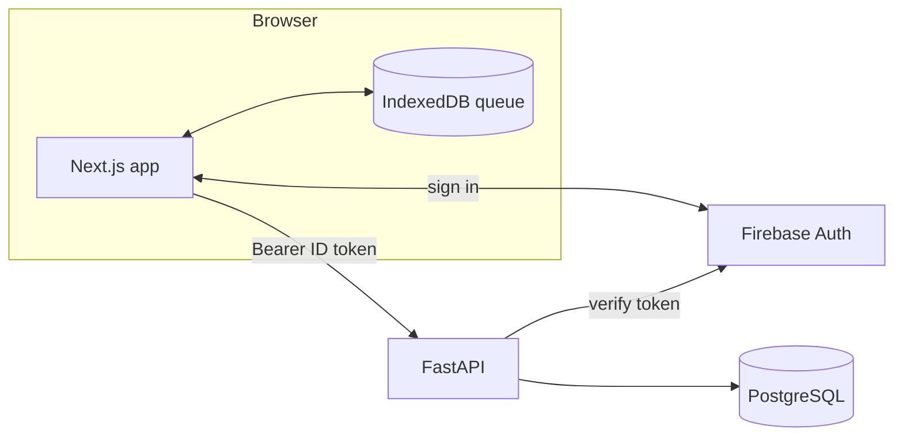
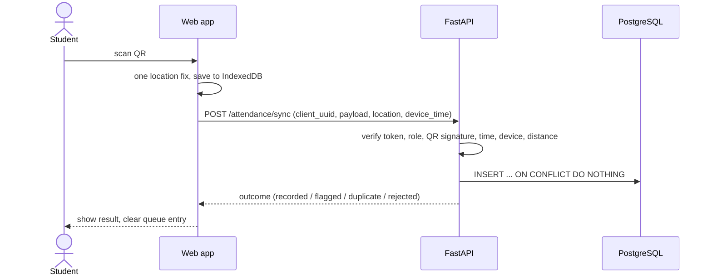
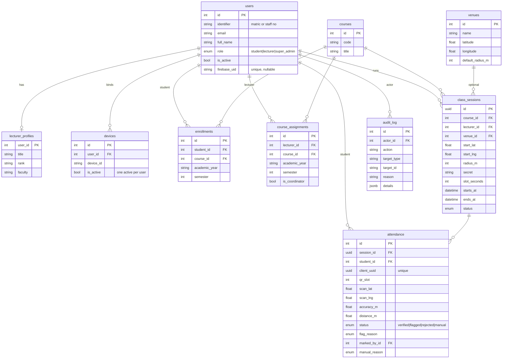

# University Attendance System

A QR-and-location attendance system for university classes. A lecturer opens a session and shows a QR code that
changes every 20 seconds; students scan it on their phones; the server checks the signature, timing, enrolment,
device and distance from the venue. It is built to keep working on weak campus networks: scans are saved on the
phone and synced later.

> **Status (verified 2026-10-30):** runs locally; 145 API tests and 82 web tests pass; a scripted browser run
> (17 checks) passed. **Not deployed.** Firebase login and the Docker images were **not** exercised in the authoring
> environment. See [What is implemented](#what-is-implemented-partial-and-planned).

Further reading: [Architecture](docs/ARCHITECTURE.md) · [Technical deep dive](docs/TECHNICAL_DEEP_DIVE.md) ·
[User guide](docs/USER_GUIDE.md) · [Presentation guide](docs/PRESENTATION_GUIDE.md) ·
[Security and privacy](docs/SECURITY_AND_PRIVACY.md)

## Contents

1. [Overview](#overview) · 2. [Requirements and scope](#requirements-and-scope) · 3. [Roles](#roles-and-permissions) ·
4. [Workflows](#workflows) · 5. [How QR and location work](#how-the-qr-and-location-checks-work) ·
6. [Architecture](#architecture) · 7. [Database](#database-design) · 8. [API](#api) · 9. [Tech choices](#technology-choices) ·
10. [Folders](#folder-structure) · 11. [Install and run](#install-and-run) · 12. [Configuration](#configuration) ·
13. [Testing](#testing) · 14. [Security](#security-and-privacy-summary) · 15. [Deployment](#deployment) ·
16. [Limitations](#limitations) · 17. [How to explain this project](#how-to-explain-this-project) · 18. [Glossary](#glossary)

## Overview

**Problem.** Paper registers are slow and easy to forge. A single shared QR code can be photographed and sent to
absent friends. University networks are often unreliable, so an app that needs a live connection fails in class.

**Solution.** A rotating signed QR (expires in seconds), a location check against the venue, device binding, an
offline queue on the student's phone, and a lecturer workflow for exceptions (flagged scans, students without
phones). Every sensitive action is audited.

**Not claimed:** it cannot prove physical presence. See [Limitations](#limitations).

## Requirements and scope

Built and working:

* Admin-managed users, courses, venues, enrolments, lecturer assignments (single and bulk import for users).
* Lecturer session creation, live QR, roster, close/cancel, flagged-scan review, manual marking with reasons.
* Student scan, offline queue, history and percentages.
* Course reports with 75 % eligibility and CSV export; audit log; admin overview.

Out of scope / not built: push notifications, excused-absence workflow, timetable import, native mobile apps,
course representatives (deliberately removed: only three roles), email sending, multi-institution tenancy.

## Roles and permissions

| Capability | Student | Lecturer | Super admin |
|---|:-:|:-:|:-:|
| Sign in (account pre-created by admin) | ✔ | ✔ | ✔ |
| Scan attendance / see own history | ✔ | | |
| Create / close / cancel sessions | | own courses | ✔ |
| Show QR, see roster | | own sessions | ✔ |
| Review flagged scans | | own courses | ✔ |
| Mark manually | | own courses, within 24 h of end | ✔ any time |
| Course reports + CSV | | own courses | ✔ |
| Manage users, courses, venues, enrolments | | | ✔ |
| Reset a student's device | | | ✔ |
| Read audit log | | | ✔ |

Roles come from the `users.role` column, never from the token.

## Workflows

**Account linking.** An admin creates a user with an email. On first sign-in the API verifies the Firebase token,
finds the user by *verified* email, and stores the `firebase_uid`. No user row → access refused.

**Class.** Lecturer creates a session → shows the QR → students scan → server records outcome → lecturer reviews
flags → lecturer closes the session → percentages include it.

**Student without a phone.** Lecturer marks them manually, choosing a reason; stored with lecturer id and audited.

**New phone.** Student's first scan on the new phone is flagged `device_mismatch`; an admin resets the binding.

## How the QR and location checks work

Short version (details and pseudocode in [TECHNICAL_DEEP_DIVE.md](docs/TECHNICAL_DEEP_DIVE.md)):

```text
QR = v1.<session_id>.<slot>.<HMAC(secret, session_id:slot)[:22]>     slot = floor((now - start)/20s)

on sync(scan):
    if duplicate client_uuid           -> duplicate
    if bad signature / not enrolled / session not found / session closed (online) -> rejected
    if slot not within time window     -> rejected (online) or flagged clock_skew (offline)
    if device differs from bound one   -> flagged device_mismatch
    if no location                     -> flagged no_location
    if accuracy > 100 m                -> flagged low_accuracy
    if distance - accuracy > radius    -> rejected outside_radius
    else                               -> recorded (verified)
```

Limits: GPS spoofing, live QR relaying and a student-set phone clock for offline scans. Mitigations are expiry,
geofence, device binding, flags and audit.

## Architecture



Sequence of one scan:



More diagrams (lifecycle state machine, full sequence) are in [docs/ARCHITECTURE.md](docs/ARCHITECTURE.md).

## Database design

Ten tables. Enums are stored by name in PostgreSQL. The authoritative definition is `apps/api/app/models` and the
single Alembic migration.



Important constraints: `UNIQUE(session_id, student_id)`; unique `client_uuid`; partial unique index on `devices`
`WHERE is_active`; `ck_attendance_scan_or_manual` (manual rows need marker + reason, scan rows need client_uuid,
slot and device time). `rejected` exists as an enum value but rejected scans are not persisted. The `devices.public_key`
column is reserved and unused.

## API

Base path `/api/v1`. Interactive docs at `/docs` in development (disabled in production). Errors use
`{"error": {"code", "message", "details"}}`. All endpoints except `/health` require `Authorization: Bearer <token>`
(dev provider: `dev:<email>`).

| Method & path | Role | Purpose |
|---|---|---|
| GET `/health` | none | liveness |
| GET `/auth/me`, POST `/auth/device` | any | current user; register device |
| GET/POST `/users`, GET/PATCH `/users/{id}`, POST `/users/import`, POST `/users/{id}/reset-device` | admin | user management |
| GET/POST `/courses`, PATCH `/courses/{id}` | admin (list: scoped) | courses |
| GET/POST/DELETE `/courses/{id}/assignments` | admin | lecturer assignments |
| GET/POST/DELETE `/courses/{id}/enrollments` | admin | enrolments |
| GET/POST `/venues`, PATCH `/venues/{id}` | admin (read: lecturer) | venues |
| POST/GET `/sessions`, GET `/sessions/{id}` | lecturer/admin | create, list, detail |
| GET `/sessions/{id}/qr`, `/qr-seed`, `/roster` | owner/admin | QR, signing seed, live roster |
| POST `/sessions/{id}/close`, `/cancel` | owner/admin | lifecycle |
| POST `/sessions/{id}/attendance/manual` | lecturer/admin | manual mark |
| POST `/attendance/{id}/review` | lecturer/admin | approve or reject flagged scan |
| POST `/attendance/sync` | student | batch of scans (≤100), idempotent |
| GET `/attendance/me`, `/me/attendance-summary`, `/me/courses` | student | own history |
| GET `/courses/{id}/report`, `/report.csv` | lecturer/admin | percentages, CSV |
| GET `/admin/overview`, `/admin/audit` | admin | totals, audit log |

Example sync request and response:

```json
POST /api/v1/attendance/sync
{"scans": [{"client_uuid": "0b6f3c1e-8a52-4d0e-9f57-2c1d6a7e4b10", "qr_payload": "v1.<session-uuid>.42.<sig>",
            "device_id": "device-abc12345", "device_time": "2026-10-30T09:05:12Z",
            "scan_lat": 7.5186, "scan_lng": 4.5213, "accuracy_m": 12}]}

200 {"results": [{"client_uuid": "0b6f3c1e-...", "outcome": "recorded", "code": "verified",
                  "message": "...", "attendance_status": "verified", "distance_m": 14.2}]}
```

(Field names are authoritative in `apps/api/app/schemas/attendance.py` and `/docs`.)

## Technology choices

| Choice | Reason |
|---|---|
| FastAPI + Pydantic v2 | typed validation, automatic OpenAPI docs, async |
| SQLAlchemy 2 async + Alembic | explicit models, versioned migrations |
| PostgreSQL 16 | real constraints, partial indexes, JSONB, `ON CONFLICT` |
| Next.js (App Router) + TypeScript strict + Tailwind | team strength, camera/geolocation in the browser, no app-store install |
| Firebase Authentication | no password code to write or secure; roles stay in our DB |
| IndexedDB queue | survives reloads and offline periods |
| pytest against real PostgreSQL | constraints and races are part of the behaviour |

## Folder structure

```text
.
├── apps/
│   ├── api/       FastAPI: app/{core,models,schemas,api,services,repositories}, migrations/, scripts/seed.py, tests/
│   └── web/       Next.js: app/, features/, components/, lib/, hooks/, types/, tests/
├── e2e/           Playwright smoke script (manual, not run in CI)
├── docs/          deeper documentation
├── docker-compose.yml, .env.example, .github/workflows/ci.yml
```

## Install and run

Requirements: Python 3.11+, Node 20+, PostgreSQL 16 (or Docker).

### 1. Database

```bash
createuser attendance --pwprompt          # or use your own role
createdb attendance -O attendance
createdb attendance_test -O attendance    # for the test suite
```

### 2. API

```bash
cd apps/api
python3 -m venv .venv && source .venv/bin/activate
pip install -r requirements-dev.txt
cp ../../.env.example ../../.env          # then edit: set DATABASE_URL, AUTH_PROVIDER=dev for local use
alembic upgrade head
python -m scripts.seed                    # fictional demo data (refuses to run in production)
uvicorn app.main:app --reload --port 8000
```

### 3. Web

```bash
cd apps/web
npm ci
# NEXT_PUBLIC_API_URL=http://localhost:8000/api/v1 and NEXT_PUBLIC_AUTH_MODE=dev for local use
npm run dev
```

Open http://localhost:3000 and sign in with a seeded fictional email: `admin@example.edu`, `lecturer1@example.edu`,
`student1@example.edu` (no password in dev mode). Camera and location need `localhost` or HTTPS.

### Docker Compose (not run in the authoring environment)

```bash
cp .env.example .env     # set a database password
docker compose up --build
```

Only `docker compose config` was validated; the images were never built here, so expect to debug the first run.

## Configuration

All variables are in `.env.example`. Key ones: `DATABASE_URL`, `ENVIRONMENT`, `AUTH_PROVIDER` (`firebase`|`dev`),
`FIREBASE_PROJECT_ID`, `FIREBASE_CREDENTIALS_JSON`/`_PATH`, `CORS_ORIGINS`, `CURRENT_ACADEMIC_YEAR`,
`CURRENT_SEMESTER`, plus tunables in `apps/api/app/core/config.py` (slot length, tolerance, grace, radius, accuracy
limit, rate limits, 75 % threshold, 24 h correction window). `NEXT_PUBLIC_*` values are compiled into the browser
bundle: never put secrets there. Never commit `.env`.

## Testing

```bash
cd apps/api && pytest -q            # needs PostgreSQL and the attendance_test database
cd apps/api && ruff check . && ruff format --check .
cd apps/web && npm test && npm run typecheck && npm run lint && npm run build
node e2e/smoke.mjs                  # manual browser run; needs API + web running with dev auth and seed data
```

Results on 2026-10-30:

| Suite | Result |
|---|---|
| API (pytest, real PostgreSQL) | **145 passed** |
| Web (Vitest) | **82 passed** |
| ruff, ESLint, `tsc --noEmit`, `next build` | clean |
| `npm audit --omit=dev` | 0 vulnerabilities |
| Browser smoke (Playwright, 17 checks) | passed; used manual code entry, so camera frames were not exercised |

CI (`.github/workflows/ci.yml`) is written but has **not** run, because the repository has not been pushed to a
GitHub Actions runner yet.

## Security and privacy summary

Server-side authorisation on every endpoint, signed expiring QR, unique constraints, audited sensitive actions,
CSV injection protection, rate limits, production guards on dev auth and CORS, secrets kept out of git. Location is
read once per scan. Full list and known gaps: [docs/SECURITY_AND_PRIVACY.md](docs/SECURITY_AND_PRIVACY.md).

## Deployment

Not deployed. A production checklist is in [docs/ARCHITECTURE.md](docs/ARCHITECTURE.md#7-deployment).

## Limitations

* GPS and QR relaying can be abused by a determined student; offline scan time is self-reported.
* Rate limiter is per process.
* Firebase mode and Docker images are untested here.
* Excused absences are not modelled; rejected scans are not stored.
* No retention job for location data; no email notifications; no timetable integration.
* Session status is updated lazily on access (no scheduler).

## What is implemented, partial and planned

| Area | State |
|---|---|
| Schema, migration, constraints | implemented, tested |
| QR signing/verification, geofence, sync rules | implemented, tested |
| Roles, admin tools, audit, reports, CSV | implemented, tested |
| Student scan UI, offline queue, lecturer console | implemented, unit tested + browser smoke |
| Firebase token verification | implemented, **not tested live** |
| Docker images, compose, CI workflow | written, **not run** |
| Camera decoding in a real phone | partial: component tested with mocks; jsQR decode of a rendered QR verified |
| Shared rate limiting, backups, monitoring | planned |
| Excused absences, notifications, data retention | planned |

## How to explain this project

**30 seconds:** see [the presentation guide](docs/PRESENTATION_GUIDE.md#30-second-pitch).

**Two minutes:** problem (proxy attendance, bad network) → rotating signed QR plus location → server decides →
offline queue → human review for edge cases → honest limits.

**Five minutes:** live demo script in [docs/PRESENTATION_GUIDE.md](docs/PRESENTATION_GUIDE.md#5-minute-walkthrough-live-demo).

**FAQ**

* *Why not trust the phone?* The student controls it; the server verifies.
* *Why does a QR from a photo fail?* The slot is signed and expires in about 20 s (plus tolerance).
* *What happens offline?* The scan waits in IndexedDB and syncs later, with a weaker timing check.
* *What if GPS is poor?* The scan is flagged for the lecturer, not rejected.
* *Why PostgreSQL constraints?* They keep data correct even under concurrent requests.

**Key decisions:** three roles only; Firebase for identity, roles in our DB; flag over reject when unsure; manual
marking always has a reason and an audit entry; lazy session finalization.

## Glossary

**Slot** a 20 s QR window · **HMAC** keyed hash · **Geofence** circle around a venue · **Haversine** distance on a
sphere · **Idempotent** repeating gives the same result · **Flagged** awaiting review · **Finalized** closed session ·
**Alembic** migration tool · **ASGI** async Python web interface.
