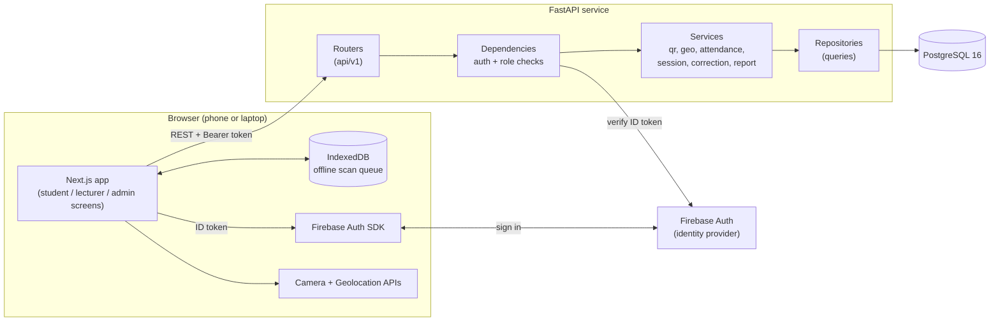
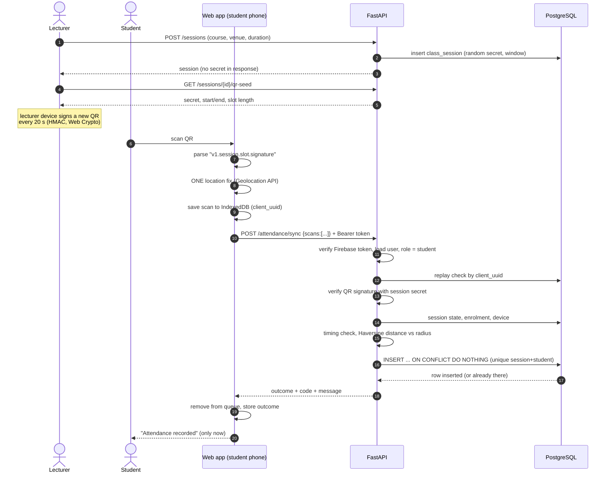
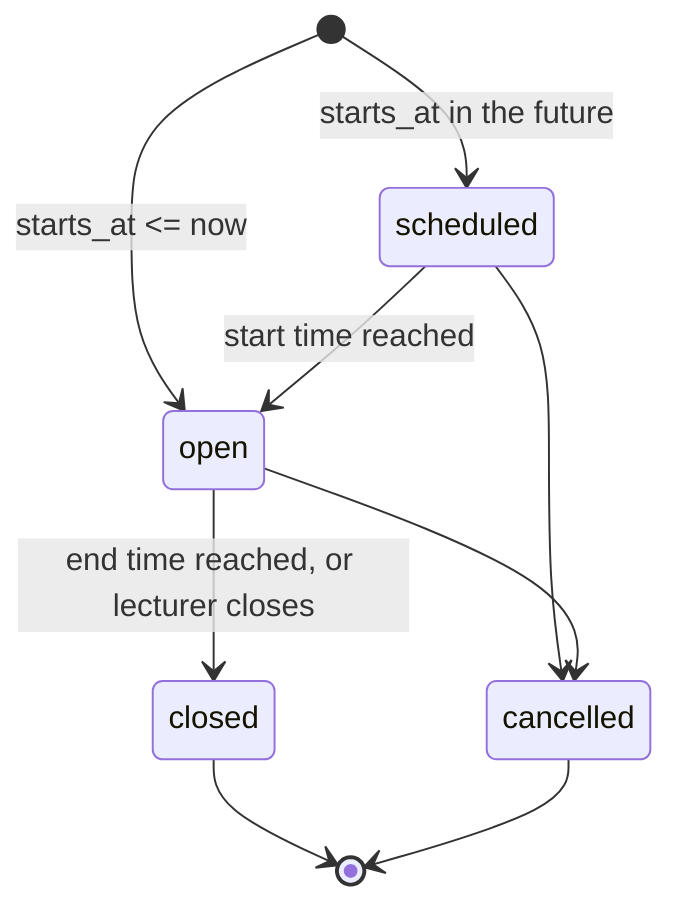

# Architecture

This document explains how the pieces fit together and why. For the QR and location logic in detail see
[TECHNICAL_DEEP_DIVE.md](TECHNICAL_DEEP_DIVE.md); for protections and limits see
[SECURITY_AND_PRIVACY.md](SECURITY_AND_PRIVACY.md).

## 1. The big picture



* **Next.js** is a thin client. It displays data, reads the camera and the GPS, and keeps scans in a local queue when
  the network is down. It never decides whether attendance counts.
* **FastAPI** owns every decision: who you are (token verification), what you may do (role + course assignment), and
  whether a scan is valid (QR signature, timing, enrolment, device, geofence).
* **PostgreSQL** is the system of record. Its constraints (one record per student per session, one active device per
  student, scan-or-manual rule) are the last line of defence against bugs and races.
* **Firebase Authentication** only proves identity. Roles live in our own `users` table.

## 2. Backend layers

```
apps/api/app
├── main.py            application factory, CORS, error handlers
├── core/              settings, DB engine, auth providers, errors, rate limiter
├── models/            SQLAlchemy tables (one file per area)
├── schemas/           Pydantic request/response shapes (never expose secrets)
├── api/
│   ├── deps.py        get_current_user, require_roles
│   └── v1/            routers: auth, users, courses, venues, sessions, attendance, reports
├── services/          business rules (pure where possible)
└── repositories/      small query helpers shared by services
```

Dependencies point one way: `api → services → repositories → models`. A router validates input, calls a service and
returns a schema. The attendance rules live in `services/attendance_service.py`, `qr_service.py` and
`geo_service.py`, so they are tested without HTTP. `qr_service` and `geo_service` are pure functions with no database
and no clock.

## 3. Frontend structure

```
apps/web
├── app/               routes (App Router): login, (app)/student, (app)/lecturer, (app)/admin
├── features/          screens with logic: check-in, scanner, QR display, session console, admin tools
├── components/        app shell and UI primitives (button, card, form, table, badge...)
├── lib/               api client, auth context, qr (Web Crypto), geo, offline queue, scan flow
├── hooks/             useFetch, useOnline
├── types/             TypeScript types mirroring the API
└── tests/             Vitest + Testing Library
```

Route protection in `app/(app)/layout.tsx` is a convenience that redirects the wrong role. The real protection is the
API: every endpoint re-checks the role and the course assignment.

## 4. One complete attendance attempt



If the network is down at step 7, the scan stays in IndexedDB; the app retries when the connection returns. The server
treats repeats as the same scan (`client_uuid` is unique), so retries never double count.

## 5. Session lifecycle



There is no background worker. The status change is applied (and saved) the next time anyone reads or scans the
session ("lazy finalization"). **Closed** is what "finalized" means: only closed sessions count in percentages.
Closing early shortens `ends_at` to now, so later QR slots can never be valid.

## 6. Data model

The full diagram and table notes are in the [README](../README.md#database-design). Key rules enforced by the
database:

| Rule | How |
|---|---|
| One attendance row per student per session | `UNIQUE (session_id, student_id)` |
| A phone's retry is the same scan | `UNIQUE (client_uuid)` |
| Scanned rows carry scan data; manual rows say who and why | `CHECK ck_attendance_scan_or_manual` |
| One active phone per student | partial unique index `WHERE is_active` |
| No duplicate enrolment / assignment | unique constraints on (student, course, year, semester) |

## 7. Deployment

**Local development** (documented in the README): PostgreSQL, API and web run on one machine, either directly or with
Docker Compose. `AUTH_PROVIDER=dev` lets you sign in with an email only. It is refused at startup when
`ENVIRONMENT=production`.

**Production checklist** (not performed by this repository, because no deployment was done):

1. Run PostgreSQL as a managed service with automated backups and point-in-time recovery; give the API a
   least-privilege user.
2. Serve both apps over **HTTPS** only. Browsers refuse camera and location access on insecure origins, so scanning
   will not work without it.
3. Set `ENVIRONMENT=production`, `AUTH_PROVIDER=firebase`, a Firebase service account in your platform's secret
   manager, and `CORS_ORIGINS` to the exact web origin (a wildcard is refused).
4. Build the web image with the production `NEXT_PUBLIC_*` values (they are compiled into the bundle).
5. Run `alembic upgrade head` as a release step before starting new API containers. The app never creates tables.
6. Put a shared rate limiter (reverse proxy or Redis) in front: the built-in one is per process.
7. Collect logs and add uptime and error monitoring. The API exposes `GET /health` for liveness checks.
8. Run more than one API instance only after replacing the in-memory rate limiter.

## 8. Key decisions

| Decision | Why | Trade-off |
|---|---|---|
| Server decides, phone reports | A browser can be modified, so it cannot be trusted | needs a round trip (solved by the offline queue) |
| Signed QR slots instead of server-issued tokens | the server can verify a scan later, so offline check-in works | the secret must be protected; the lecturer device holds it for the session |
| Firebase for identity, roles in our DB | no password handling code; role changes take effect immediately | two systems to keep in step (admins pre-create users, link on first sign-in) |
| `ON CONFLICT DO NOTHING` insert | race-free duplicate prevention without locks | the loser must read the winner's row |
| Lazy session finalization | no scheduler to deploy | status updates when someone touches the session |
| Flag instead of reject when unsure (weak GPS, clock skew, other phone) | indoor GPS is unreliable; a human decides | lecturers must review flagged scans |
| Rejected scans are not stored | keeps the table to real attendance; the phone shows the reason | no server-side history of failed attempts |
